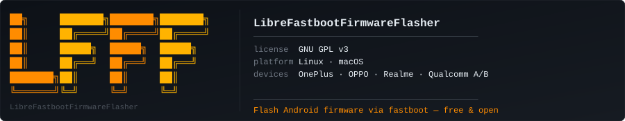
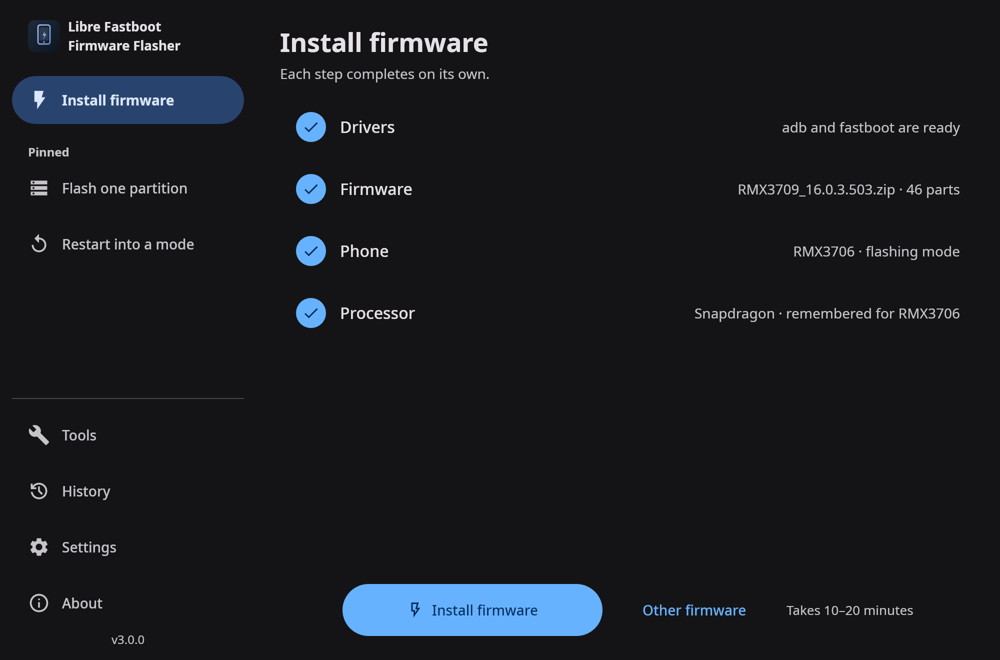

<div align="center">



[](https://www.gnu.org/licenses/gpl-3.0)
[](https://www.rust-lang.org)
[](https://slint.dev)
[](https://github.com/mrFrok/LibreFastbootFirmwareFlasher)
[](https://github.com/mrFrok/LibreFastbootFirmwareFlasher/releases)

**Free, open-source firmware flasher for Android A/B phones, over fastboot.**  
A desktop app and a command-line tool, written in Rust, no bloat. The CLI is one static binary that runs on any Linux,
Termux included.

[Installation](#installation) · [Quick start](#quick-start) · [How flashing works](#how-flashing-works) · [CLI commands](#cli-commands) · [Tested devices](#tested-devices) · [Development](#development)



</div>

---

## About

LibreFastbootFirmwareFlasher flashes full firmware on **OnePlus, OPPO and
realme** phones with an A/B layout: Snapdragon, and MediaTek in part. It
handles the whole job — finding and downloading the official build,
unpacking it, checking the phone, Anti-Rollback, the super partition and its
layout, the slots and the modem.

- **GUI** (`lfff-gui`) — a desktop app built with [Slint](https://slint.dev)
- **CLI** (`lfff`) — the same, scriptable, for a terminal or Termux

What it does:

- Full firmware flash across both slots, or a single partition
- Official firmware search on the OPPO / OnePlus / realme servers, every region at once
- Multi-connection download and OTA unpacking
- Anti-Rollback check: the phone against the firmware
- Super rebuilt from the firmware's layout, so system updates keep installing
- Custom ROMs, with super rebuilt from the ROM (at your own risk)
- Flashing a source build's output folder
- Retry, skip or abort a failed partition
- Installs its own tools (`fastboot`, `adb`, `aria2c`, `payload_dumper`)

Links: [Author](https://t.me/mrFrok228) · [Telegram group](https://t.me/lfffcomunity) · [realme community](https://t.me/gt3neo5hub) · [OnePlus community](https://t.me/oneplusmod) · [Donate](https://boosty.to/mrfrok/donate)

---

## Installation

| System | Command |
|---|---|
| Any Linux, macOS | `curl -fsSL https://raw.githubusercontent.com/mrFrok/LibreFastbootFirmwareFlasher/main/install.sh \| bash` |
| Arch Linux (AUR) | `yay -S lfff` (from source) or `yay -S lfff-bin` (prebuilt) |
| macOS (Homebrew) | `brew install --cask librefastbootfirmwareflasher` (after the tap, below) |
| Linux (Homebrew) | `brew install lfff` (after the tap, below) |
| Linux x86_64 | Flatpak or AppImage from the [release page](https://github.com/mrFrok/LibreFastbootFirmwareFlasher/releases) |
| Nix / NixOS | `nix profile install github:mrFrok/LibreFastbootFirmwareFlasher` |
| Termux (Android) | the one-liner with `--cli-only` |

Except for Flatpak, install the external tools afterwards with `lfff deps`.

### One-liner (any Linux, macOS)

```bash
curl -fsSL https://raw.githubusercontent.com/mrFrok/LibreFastbootFirmwareFlasher/main/install.sh | bash

# Flags: --cli-only | --gui-only | --uninstall
```

Installs to `~/.local/bin`, so it works on every distribution, atomic and
immutable ones too (Fedora Silverblue, Bazzite, NixOS, SteamOS), and on macOS.
On musl distributions (Void, Alpine) it picks the matching GUI build
(`lfff-gui-linux-<arch>-musl.tar.gz`); the CLI is static and the same
everywhere.

### Termux (Android)

The CLI only: there is no display server for the GUI.

```bash
curl -fsSL https://raw.githubusercontent.com/mrFrok/LibreFastbootFirmwareFlasher/main/install.sh | bash -s -- --cli-only
pkg install android-tools    # fastboot and adb
```

### Arch Linux (AUR)

```bash
yay -S lfff         # build from source
yay -S lfff-bin     # prebuilt binary
```

### Homebrew

On macOS, the app goes to /Applications together with the command-line tool:

```bash
brew tap mrFrok/lfff
brew trust mrfrok/lfff   # current Homebrew asks this of third-party taps
brew install --cask librefastbootfirmwareflasher
```

On Linux, or for just the command-line tool on macOS:

```bash
brew tap mrFrok/lfff
brew trust mrfrok/lfff
brew install lfff
```

If `brew trust` is an unknown command, your Homebrew predates it — skip that
line. On macOS, `brew tap` needs git from Apple's Command Line Tools. If it
fails with *"No developer tools installed"* or *"Git is unavailable"*, run
`xcode-select --install`, then the commands above again.

### Flatpak (Linux x86_64)

```bash
flatpak install lfff-gui-linux-x86_64.flatpak   # from the release page
```

Bundles fastboot, adb, aria2 and payload-dumper, so `lfff deps` is not needed.
The host still needs the usual udev rules for the phone to show up.

### AppImage (Linux)

```bash
chmod +x LibreFastbootFirmwareFlasher-*-x86_64.AppImage
./LibreFastbootFirmwareFlasher-*-x86_64.AppImage
```

Ships the GUI and the CLI; the external tools come from the host, via `lfff deps`.

### Nix / NixOS

```bash
nix profile install github:mrFrok/LibreFastbootFirmwareFlasher          # GUI
nix profile install github:mrFrok/LibreFastbootFirmwareFlasher#lfff-cli # CLI only

nix run github:mrFrok/LibreFastbootFirmwareFlasher        # run the GUI without installing
nix run github:mrFrok/LibreFastbootFirmwareFlasher#cli    # run the CLI without installing

nix develop github:mrFrok/LibreFastbootFirmwareFlasher    # development shell
```

### Uninstall

```bash
curl -fsSL https://raw.githubusercontent.com/mrFrok/LibreFastbootFirmwareFlasher/main/install.sh | bash -s -- --uninstall
```

---

## Quick start

**GUI:** run `lfff-gui`, connect the phone, pick or search for a firmware,
then press Install. The app walks through the warnings and restarts the
phone into the right mode itself.

**CLI:**

```bash
lfff deps                                  # install fastboot, adb, aria2c, payload_dumper
lfff find-ota CPH2747                      # official firmware, every region
lfff find-ota CPH2747 --latest | lfff download -   # download the newest
lfff download https://.../firmware.zip     # download an OTA by link
lfff extract firmware.zip                  # unpack it
lfff flash ./firmwares/RMX3709             # flash it
lfff flash --source /out/target/product/   # flash a source build

# Each step prints only its result on stdout, so they chain:
lfff extract "$(lfff find-ota CPH2747 --latest | lfff download -)"
```

OTAs are unpacked with [payload-dumper-rust](https://github.com/rhythmcache/payload-dumper-rust).
Some distributions (NixOS among them) ship an unrelated Python script under
the same `payload_dumper` name; LibreFastbootFirmwareFlasher detects it and
ignores it. If your copy lives somewhere unusual, point to it:

```bash
export LFFF_PAYLOAD_DUMPER=/path/to/payload_dumper
```

---

## How flashing works

You choose the method — Snapdragon or MediaTek — it is never guessed.
Before anything is written, the Anti-Rollback warning comes first (Snapdragon),
then the final confirmation.

### Snapdragon: the route follows the firmware's Android

The version is read from the OTA's metadata when it is unpacked.

| Firmware | Route |
|---|---|
| Android 16 and older | Dynamic partitions to the active slot in fastbootd, then the bootloader for the modem, both slots |
| Android 17 | Everything in fastbootd, with a switch to the other slot |
| Version unknown | You choose the route; there is no default |
| realme GT Neo 5 family (RMX3700, RMX3701, RMX3706, RMX3708, RMX3709) | Always through the bootloader, any Android; recognised by the firmware or the phone |

Flashing ColorOS 17 through the bootloader can brick the phone, so outside the
GT Neo 5 family that route is refused for Android 17 even when forced. Force
a route with `--method snapdragon-bootloader` or `--method snapdragon-fastbootd`
(GUI: Settings → Firmware → Modem via bootloader).

The Android 17 route, step by step — fastbootd can only write the modem of the
slot it is not running from, so the slot is switched first:

```
[fastbootd]
  set_active → the other slot
  Non-super partitions  →  slot A  +  slot B
  modem                 →  new active slot
  Super/dynamic parts   →  new active slot (super rebuilt first if that slot is empty)
      ↓
[Offer: reboot to system  /  wipe data + reboot]
```

The old slot keeps its old modem. A flash with a modem but no system images is
refused rather than sent to the bootloader. Partitions you choose not to flash
(a rooted `init_boot`, say) are copied from the phone's active slot over adb
as root before the switch and written to the new slot; if they cannot be
copied, nothing is flashed.

### The super partition

When the slot being flashed has no partitions (usual on Virtual A/B), super is
rebuilt from the firmware's layout with `fastboot wipe-super` — groups and
read-only partitions as from the factory — so system updates keep working.
`my_company` and `my_preload`, which some firmware leaves out, get empty
factory images. Turn it off with `--no-rebuild-super` (GUI: Settings → Super
partition).

### Custom ROMs (at your own risk)

Custom ROMs carry only their own partitions, without the factory `my_*` ones.
Tick **Custom ROM** on the install's last step (`lfff flash --custom-rom`):
super is wiped and rebuilt from the ROM's layout, whatever the phone had.

- Both slots lose everything in super; partitions the ROM lacks are deleted.
- The ROM must be unpacked from its .zip with `payload.bin`: that is where the layout comes from.
- Nothing is flashed if the layout cannot be built, or does not match the ROM's images.
- If the install stops halfway, the phone does not start until it is flashed again; fastboot stays available.

### MediaTek

MediaTek phones are flashed entirely in fastbootd. If the firmware has a
preloader, you are warned first and can leave it out. They have no
Anti-Rollback: it is Qualcomm-specific.

### When a partition fails

Retry it, restart the phone, skip the partition, or abort.

---

## CLI commands

| Command | What it does | Example |
|---|---|---|
| `flash <dir>` | Full firmware flash, A/B slots | `lfff flash ./fw --dry-run` |
| `flash-partition` | Flash a single partition | `lfff flash-partition boot --firmware-dir ./fw` |
| `extract <zip>` | Unpack an OTA with payload_dumper | `lfff extract fw.zip -o ./out` |
| `find-ota <model>` | Official builds from the OPPO / OnePlus / realme servers | `lfff find-ota CPH2747 -r EU --changes` |
| `download <url>` | Multi-connection download; `-` reads the link from stdin; `--md5` checks the archive | `lfff download <url> -c 8` |
| `devices` | List fastboot/adb devices | `lfff devices --check` |
| `reboot [to]` | Restart to system, recovery, bootloader or fastbootd | `lfff reboot bootloader` |
| `set-slot <a\|b>` | Make a slot the active one (fastboot/fastbootd) | `lfff set-slot b` |
| `arb` | Compare ARB, firmware against phone (`--device` reads the phone over adb, needs root) | `lfff arb --device --firmware-dir ./fw` |
| `deps [tool..]` | Install missing tools | `lfff deps` / `lfff deps --check` |
| `completion <shell>` | Print a shell completion script | `lfff completion zsh` |

Every flag: `lfff <command> --help`.

stdout carries only a command's result — a link, a path, `MODE<TAB>SERIAL`
lines from `devices` — and everything else (progress, reports, prompts,
errors) goes to stderr. Exit codes: `0` success, `1` failure, `2` usage
error. `flash` asks for confirmation and needs a terminal; without one only
`--dry-run --method …` runs.

### Shell completions

The script goes to stdout; put it wherever your shell looks for one.
Supported: bash, zsh, fish, powershell, elvish, nushell.

```bash
lfff completion bash > ~/.local/share/bash-completion/completions/lfff
lfff completion zsh  > ~/.zfunc/_lfff            # with ~/.zfunc on $fpath
lfff completion fish > ~/.config/fish/completions/lfff.fish
```

---

## Tested devices

| Device | Model | Status |
|--------|-------|--------|
| realme GT Neo 5 | RMX3709 | Works |
| realme GT Neo 5 SE | RMX3700 | Works |
| OnePlus 15 | CPH274X | Works |
| OnePlus 13R / Ace 5 | CPH2645 / PJZ110 | Works |

Other OnePlus / OPPO / realme phones with a Snapdragon SoC and an A/B layout
should work. MediaTek phones may.

---

## Development

```bash
git clone https://github.com/mrFrok/LibreFastbootFirmwareFlasher
cd LibreFastbootFirmwareFlasher
cargo build --release -p lfff-cli     # CLI only
cargo build --release -p lfff-gui     # GUI only
cargo test
```

```
LibreFastbootFirmwareFlasher/
├── Cargo.toml               # workspace: lib, ota, cli, gui
├── CHANGELOG.md             # each section becomes the release notes
├── README.md
├── LICENSE
├── flake.nix
├── install.sh
├── lfff-gui.desktop
├── lfff-gui.svg
├── logo.svg
├── packaging/
│   └── flatpak/             # manifest + AppStream metadata
├── scripts/
│   ├── update-packaging.py  # repoints flake/AUR/Homebrew/Flatpak at a release
│   ├── release-notes.py     # release notes from CHANGELOG.md
│   └── build-gui-musl.sh    # GUI for musl distributions
├── lib/                     # lfff-lib: everything but the interface
│   └── src/
│       ├── lib.rs
│       ├── arb.rs           # Anti-Rollback from xbl_config
│       ├── deps.rs          # adb, fastboot, aria2c, payload_dumper
│       ├── device.rs
│       ├── downloader.rs    # aria2c, 4PDA links, renewing OPPO links
│       ├── extractor.rs     # payload_dumper, unpack cache
│       ├── file_ops.rs
│       ├── flash_history.rs
│       ├── flasher.rs       # the install, OTA repair
│       ├── super_layout.rs  # rebuilding super from the firmware's layout
│       └── utils.rs
├── ota/                     # lfff-ota: the OPPO / OnePlus / realme update servers
│   └── src/
│       ├── protocol.rs      # /update/v6 request and answer
│       ├── regions.rs       # 19 regions: carrier, server, model suffix
│       ├── search.rs        # every region and channel at once
│       ├── build.rs         # reading a build from the answer
│       └── changelog.rs     # "what's new"
├── cli/                     # lfff
│   └── src/
│       ├── main.rs
│       ├── cli.rs           # commands and options
│       ├── output.rs
│       └── handlers/        # one file per command
└── gui/                     # lfff-gui
    ├── build.rs
    ├── material-1.18.1/     # vendored Material 3 components (MIT)
    ├── src/
    │   ├── main.rs
    │   ├── worker.rs        # long jobs off the UI thread
    │   ├── ui_callbacks.rs
    │   ├── device_poll.rs   # finds the phone in the background
    │   ├── ota.rs           # firmware search on the install page
    │   └── config.rs
    └── ui/
        ├── main.slint
        ├── pages/
        ├── components/
        ├── dialogs/
        ├── globals/
        └── icons/
```

### Material 3 components

The GUI is built with the official [Material 3 component set for
Slint](https://material.slint.dev). It ships no crate, so a copy lives in
`gui/material-1.18.1/`, taken from `ui-libraries/material/src` of
[slint-ui/slint](https://github.com/slint-ui/slint) at tag `v1.18.1` and
licensed MIT (see `gui/material-1.18.1/LICENSE.md`). It is versioned in lockstep
with Slint, so it is refreshed from the tag matching the `slint` dependency.
`gui/build.rs` registers it as the `@material` library.

One local change, to repeat on every refresh: `MaterialTypography.medium` in
`ui/styling/material_typography.slint` is 500 (the Material 3 value) instead of
upstream's 600, which made buttons and labels too heavy.

---

## Special thanks

- [NeFeroN](https://t.me/NeFeroN) — author of the original Windows program, help with the flash implementation, Windows version
- [MisterZtr](https://github.com/MisterZtr) — partial MediaTek support
- [Houvven](https://github.com/Houvven) — OplusUpdater, whose update-server protocol (as kept current in the [RealmeOS/OplusUpdater-android](https://github.com/RealmeOS/OplusUpdater-android) fork, GPL-3.0) the firmware search is ported from
- NeFeroN's LinkResolverDownloader — how the search combines regions and reads answers, and how expiring OPPO links are handled

---

## Star history

If LibreFastbootFirmwareFlasher saved you time or a phone, a star helps others find it.

<a href="https://www.star-history.com/#mrFrok/LibreFastbootFirmwareFlasher&Date">
 <picture>
   <source media="(prefers-color-scheme: dark)" srcset="https://api.star-history.com/svg?repos=mrFrok/LibreFastbootFirmwareFlasher&type=Date&theme=dark" />
   <source media="(prefers-color-scheme: light)" srcset="https://api.star-history.com/svg?repos=mrFrok/LibreFastbootFirmwareFlasher&type=Date" />
   
 </picture>
</a>

---

## License

[GNU GPL v3](LICENSE). Uses [Slint](https://github.com/slint-ui/slint) (GPL v3) and Material Design 3 icons (Apache 2.0).
